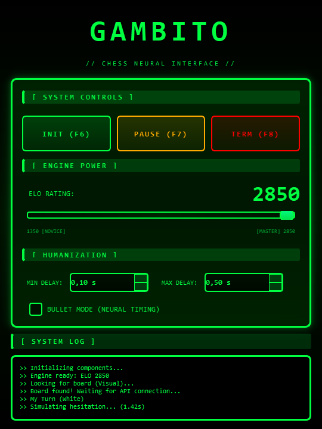

# Gambito

Bot de ajedrez para Chess.com. Combina **lectura del tablero** (una extensión de Chrome que lee el DOM, más visión por computadora con OpenCV para ubicar el tablero en pantalla), **Stockfish** con ELO configurable y **movimientos de mouse humanizados** con curvas de Bézier. Se controla desde un panel de escritorio en PySide6 o con atajos globales.

<p align="center"></p>

## Stack

Python 3.10+, PySide6, OpenCV + NumPy, python-chess, Stockfish, Flask (puente local), PyAutoGUI, pynput y una extensión de Chrome (Manifest V3, JavaScript).

## Cómo funciona

```
┌──────────────┐  DOM → FEN   ┌──────────────────┐  POST /update_fen  ┌──────────────┐
│  Chess.com   │─────────────>│ Extensión Chrome │───────────────────>│  server.py   │
│  (navegador) │              │   (content.js)   │                    │ puente Flask │
└──────────────┘              └──────────────────┘                    └──────┬───────┘
       ▲                                                                     │ GET /get_state
       │ clic / arrastre humanizado                                          ▼
┌──────┴───────┐   ┌──────────────┐   ┌──────────────┐            ┌────────────────────┐
│   input.py   │◄──│  engine.py   │◄──│  vision.py   │◄───────────│ bot_controller.py  │
│ curvas Bézier│   │  Stockfish   │   │ OpenCV       │            │ bucle de juego     │
└──────────────┘   └──────────────┘   └──────────────┘            └─────────┬──────────┘
                                                                            │ señales Qt
                                                                    ┌───────▼────────┐
                                                                    │    gui.py      │
                                                                    │ panel PySide6  │
                                                                    └────────────────┘
```

1. **Estado del tablero.** `content.js` encuentra el tablero en el DOM de Chess.com, lee las clases de cada pieza (`square-45` → columna/fila) y arma el FEN, que envía al puente local. Leer el DOM es más confiable que leer píxeles para saber qué pieza hay en cada casilla.
2. **Ubicación en pantalla.** `vision.py` captura la pantalla y busca el tablero con escala de grises, desenfoque gaussiano, detección de bordes Canny y contornos, filtrando el cuadrado grande más plausible. También detecta de qué lado juega el bot y calcula el centro de cada casilla en coordenadas de pantalla.
3. **Jugada.** `engine.py` mantiene un proceso de Stockfish con ELO configurable entre 1350 y 2850. Valida y corrige FEN inválidos antes de consultar, y reinicia el motor si se cae.
4. **Ejecución.** `input.py` mueve el mouse por una curva de Bézier cúbica con puntos de control aleatorios y una duración proporcional a la distancia, y hace el arrastre de la pieza. Soporta coronación.
5. **Ritmo.** `bot_controller.py` decide la demora antes de cada jugada. En modo normal usa el rango del panel. En **bullet** juega las primeras 10 jugadas casi al instante, después varía entre 0,05 y 1 s y en el 5 % de los casos simula una duda de 1 a 1,5 s.

Además detecta el fin de la partida (jaque mate, ahogado, etc.) a partir del FEN.

## Uso

```bash
pip install -r requirements.txt
# colocar stockfish.exe (o stockfish en Linux/macOS) en la raíz del proyecto
python gui.py          # abre el panel y levanta el puente Flask
```

Extensión: `chrome://extensions` → *Modo desarrollador* → *Cargar descomprimida* → carpeta `chrome-extension/`.

| Tecla | Acción |
| --- | --- |
| F6 | Iniciar |
| F7 | Pausar / reanudar |
| F8 | Detener |

## Estructura

| Archivo | Responsabilidad |
| --- | --- |
| `gui.py` | Panel PySide6: ELO, demoras, modo bullet, log en vivo y atajos globales |
| `bot_controller.py` | Bucle de juego en un hilo aparte; detección de turno y de fin de partida |
| `vision.py` | Detección del tablero, del lado propio y de movimientos por diferencia de imágenes |
| `engine.py` | Envoltorio de Stockfish con validación de FEN y reinicio automático |
| `input.py` | Movimientos y clics humanizados |
| `server.py` | Puente HTTP local entre la extensión y el bot |
| `chrome-extension/` | Lectura del tablero desde el DOM |

## Estado

Proyecto personal de experimentación con visión por computadora y automatización de entrada (enero de 2026). La captura muestra el panel con un log de ejemplo; para jugar hacen falta Stockfish y la extensión instalada.

Usar bots en partidas contra personas va contra los términos de Chess.com. Este repositorio es un ejercicio técnico.

## Licencia

Código propio. Stockfish se distribuye bajo GPLv3 y no está incluido en el repositorio.
